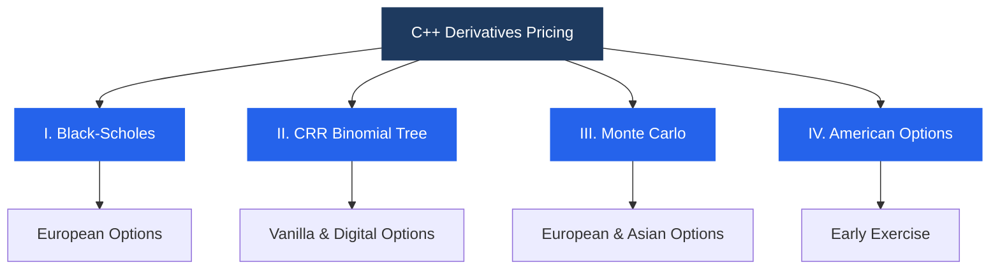

# C++ Derivatives Pricing Project

### ESILV · Financial Engineering · 2026

**Implementation of financial derivatives pricing models using C++ and object-oriented programming.**

---

## 📖 About the Project

This project is developed as part of the **C++ for Finance** course at **ESILV — École Supérieure d'Ingénieurs Léonard de Vinci**, during the fourth year of the Financial Engineering program.

The objective is to design and implement financial derivatives pricing models in C++, combining **financial mathematics, numerical methods, and object-oriented programming**.

The project covers analytical pricing, binomial tree methods, Monte Carlo simulations, and early exercise features.

---

## 🚀 Project Modules

The project is organized into four main parts:

| Module | Model | Description |
|:---:|---|---|
| **I** | Black-Scholes | European Call & Put pricing and Delta calculation |
| **II** | Cox-Ross-Rubinstein | Binomial tree pricing of European vanilla and digital options |
| **III** | Monte Carlo | Stochastic simulation, Asian options and confidence intervals |
| **IV** | American Options | Early exercise optimization and Black-Scholes approximation |

### Project Architecture

---

## 🛠️ Technologies & Concepts

**Development Environment**

- C++
- Microsoft Visual Studio 2022
- Git & GitHub

**Programming Concepts**

- Object-Oriented Programming (OOP)
- Inheritance & Polymorphism
- Abstract Classes & Virtual Functions
- Operator Overloading
- Templates & STL
- Random Number Generation

**Financial Models**

- Black-Scholes Model
- Cox-Ross-Rubinstein Binomial Model
- Monte Carlo Simulation
- Risk-Neutral Valuation

---

## 👥 Team Members

| Name | Institution | Major |
|---|---|---|
| **Thibault Michel** | ESILV | Financial Engineering |
| **Yanis Messas** | ESILV | Financial Engineering |
| **Nassim Slaouti** | ESILV | Financial Engineering |
| **Khelil Mehiri** | ESILV | Financial Engineering |

---

**ESILV — Financial Engineering · Academic Year 2026–2027**

*Developed as part of the C++ for Finance course.*

